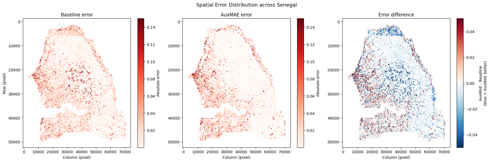
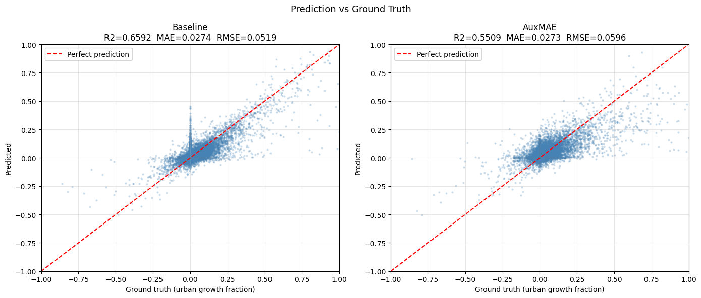

# Predicting Urban Growth in Senegal

Predicting where Senegal urbanised between 2019 and 2024 from Sentinel-1 (SAR) and Sentinel-2 (optical) satellite imagery, using a CNN regression model and an auxiliary masked autoencoder (AuxMAE) for feature augmentation.

This was my final-year project (CS310) at the University of Warwick, supervised by Prof. Hongkai Wen. The full write-up is in [`report/cs310_final_report.pdf`](report/cs310_final_report.pdf).



## Overview

- **Target:** the fraction of each 64×64 patch (10 m pixels) that became urban between 2019 and 2024, from the Esri 10 m land-cover maps (`growth = urban_2024 − urban_2019`).
- **Inputs:** Sentinel-2 dry- and wet-season imagery (2019), Sentinel-1 VV/VH SAR, 2019 land cover, and distance rasters to the nearest schools and airports (OpenStreetMap).
- **Models:**
  - Random Forest baseline
  - VGG-style CNN, tuned with Optuna
  - CNN augmented with a synthetic Sentinel-1 channel generated by an AuxMAE pre-trained to reconstruct S1 from S2
- **Scale:** across the whole country, the land-cover maps show about **868 km²** of new urban land between 2019 and 2024 and about 157 km² lost ([`results/lulc_transitions_2019_2024.txt`](results/lulc_transitions_2019_2024.txt)).

## Results

Regression on the test set (64×64 patches):

| Metric    | Random Forest | Baseline CNN | AuxMAE CNN |
|-----------|---------------|--------------|------------|
| MAE       | 0.0946        | 0.0274       | 0.0273     |
| RMSE      | 0.1265        | 0.0519       | 0.0596     |
| R²        | −1.02         | **0.659**    | 0.551      |
| Pearson r | 0.378         | **0.812**    | 0.743      |

Growth detection, i.e. whether a patch grew, using a threshold of 0.008:

| Model        | Growth precision | Growth recall | Growth F1 | No-growth F1 |
|--------------|------------------|---------------|-----------|--------------|
| Baseline CNN | 0.46             | 0.79          | 0.59      | 0.69         |
| AuxMAE CNN   | **0.66**         | **0.80**      | **0.72**  | **0.85**     |

The CNN clearly beats the Random Forest. AuxMAE augmentation does not improve the regression metrics. It does make growth detection much better, mainly by cutting false positives in areas with no change. Overall accuracy rises from 0.65 to 0.80.



## Repository structure

```
├── notebooks/
│   ├── urban_growth_pipeline.ipynb   # OSM features, preprocessing, patching, RF/CNN training, tuning, evaluation
│   └── auxmae_pretraining.ipynb      # S1/S2 alignment, MixMAE (abandoned) and AuxMAE pre-training
├── scripts/
│   ├── fetch_sentinel_data.py        # Download Sentinel imagery from Copernicus Data Space
│   ├── align_grids.py                # Align the 2024 land-cover raster to the 2019 grid
│   ├── align_images_with_lulc.py     # Reproject/resample imagery onto the land-cover grid
│   └── lulc_difference_calculation.py
├── results/                          # Metrics and figures
└── report/                           # Final report (PDF)
```

## Running it

```bash
pip install -r requirements.txt
cp .env.example .env   # add your Copernicus Data Space OAuth client ID and secret
```

1. Download the imagery with `scripts/fetch_sentinel_data.py`. It reads `CDSE_CLIENT_ID` and `CDSE_CLIENT_SECRET` from the environment.
2. Align the rasters with the scripts in `scripts/`.
3. Run `notebooks/auxmae_pretraining.ipynb` and then `notebooks/urban_growth_pipeline.ipynb` from top to bottom.

All data paths are relative to a local `data/` folder, which is git-ignored. Some of the preprocessed data is in this [Google Drive folder](https://drive.google.com/drive/folders/13DvaA9n205CQh6vC_2XgknR5vMtKH2zb?usp=drive_link). The largest rasters aren't included because of their size.

## Data sources

- Sentinel-1 and Sentinel-2: [Copernicus Data Space Ecosystem](https://dataspace.copernicus.eu/)
- Land cover: Esri 10 m Land Use/Land Cover (2019, 2024)
- Schools and airports: OpenStreetMap via `osmnx`
